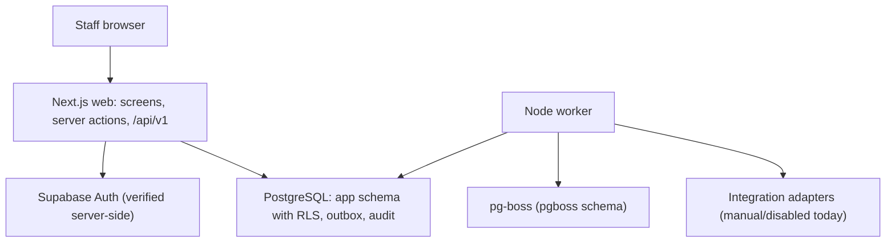

# Architecture

## Request path

1. **Identity.** Supabase `getClaims()` (or the development-only synthetic sign-in) gives a verified auth user id.
2. **Actor.** `app.resolve_memberships` (security definer, keyed only by that id) returns memberships; `@cds/auth` builds a `StaffActor` with per-branch capabilities.
3. **Command.** A server action or `/api/v1` handler validates input with the shared Zod schema and calls one domain service.
4. **Transaction.** `command()` opens a transaction, sets the RLS context transaction-locally (organisation and visible branches), and handles the idempotency key. The service locks rows in a consistent order, checks `expectedVersion`, validates rules, writes state, revision, audit and outbox rows, then commits.
5. **Side effects** happen after commit in the worker, which re-checks that the event is still current.

## Packages

| Package              | Responsibility                                                                                                                                                                                                             |
| -------------------- | -------------------------------------------------------------------------------------------------------------------------------------------------------------------------------------------------------------------------- |
| `@cds/contracts`     | Zod command schemas, state enums, error codes and HTTP mapping, capability matrix, Europe/London time resolution (DST gaps and overlaps reported, not guessed)                                                             |
| `@cds/db`            | Drizzle schema, migration runner, pooled client, `withContext`                                                                                                                                                             |
| `@cds/auth`          | Actor model, capability checks, Supabase verification, membership resolution                                                                                                                                               |
| `@cds/domain`        | Sources, orders, conflicts, amendments with impact preview, acceptance, cancellation, readiness, candidates, assignments, transport, messages, JoinedUp queue, tasks/duty, handover, board, outbox processing, read models |
| `@cds/integrations`  | Adapter contracts and status descriptors; manual messaging adapter; test-only sandbox adapter                                                                                                                              |
| `@cds/test-fixtures` | Synthetic organisation, per-test databases cloned from a migrated template, seed script                                                                                                                                    |

## Key invariants and where they are enforced

| Invariant                                                     | Enforcement                                                                                 |
| ------------------------------------------------------------- | ------------------------------------------------------------------------------------------- |
| Organisation/branch isolation                                 | RLS policies for `cds_app`; composite foreign keys; capability checks                       |
| One active assignment per worker per line                     | Partial unique index                                                                        |
| No overlapping worker/driver/vehicle reservations             | `EXCLUDE USING gist` on `resource_reservations`                                             |
| Counts nonnegative; minimum ≤ requested; accepted ≤ requested | CHECK constraints plus domain validation                                                    |
| Assigned ≤ accepted                                           | Domain check under `FOR UPDATE` lock on the line                                            |
| Seats per segment ≤ capacity                                  | Domain check under the trip lock on every revision; publication blocked on unknown capacity |
| Revisions, audit and evidence immutable                       | Runtime role has INSERT/SELECT only                                                         |
| Material change invalidates confirmations                     | `line_version` and trip `revision_no`; responses, acceptances and messages bind to them     |
| External effects not duplicated                               | Outbox with write-ahead `delivery_unknown`; idempotency keys                                |
